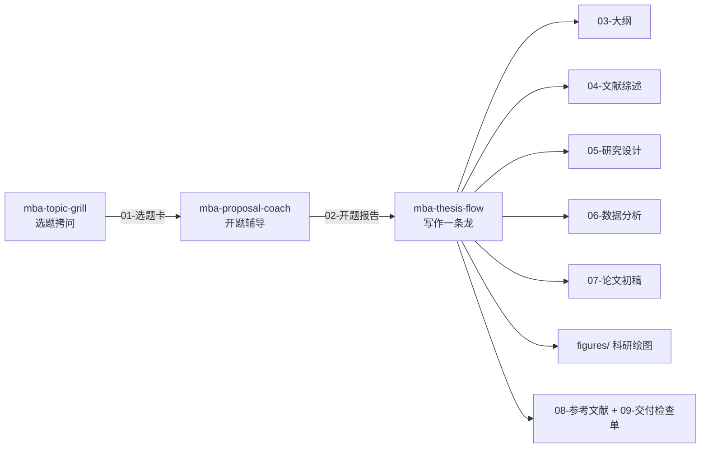

# grill-my-thesis — MBA 硕士论文全流程 Agent Skills

一套适用于任何 Agent（Claude Code、Codex、OpenClaw、ZCode 等支持 Agent Skills 规范的工具）的 MBA/EMBA 硕士论文辅助 skill，覆盖 **选题 → 开题 → 写作一条龙** 三个阶段。招牌交互是 grill 风格的选题拷问：一次一问、每问附推荐答案、模糊回答不放行。

## 套件组成

| Skill | 阶段 | 一句话定位 |
|---|---|---|
| [mba-topic-grill](mba-topic-grill/SKILL.md) | 选题 | 逐步拷问（一次一问）把模糊想法逼成可辩护的选题卡：五维评估（研究价值/数据可得性/方法可行性/创新空间/个人匹配）+ 评分收敛 |
| [mba-proposal-coach](mba-proposal-coach/SKILL.md) | 开题 | 七大件逐节辅导成稿 + "评审十问"答辩模拟，弱点改完才交付 |
| [mba-thesis-flow](mba-thesis-flow/SKILL.md) | 写作 | 七阶段流水线：大纲设计 → 文献综述 → 研究设计 → 数据分析 → 论文写作 → 科研绘图 → 参考文献，状态机推进、门禁验收 |

## 全流程



三个 skill 既可串联（前一个的产出文件是后一个的输入），也可单独使用（独立用时在 `intake` 环节补问关键信息）。

## 安装（任何 Agent）

本套件遵循开放的 Agent Skills 规范（`SKILL.md` + YAML frontmatter，仅使用 `name`、`description` 两个通用字段，无任何平台专有依赖）。

把希望使用的 skill **目录**整体复制到对应工具的 skills 目录：

| Agent | 用户级安装路径 |
|---|---|
| Claude Code | `~/.claude/skills/<skill-name>/` |
| Codex CLI | `~/.codex/skills/<skill-name>/` |
| OpenClaw | `~/.openclaw/skills/<skill-name>/` |
| ZCode | `~/.agents/skills/<skill-name>/` 或项目 `.agents/skills/` |
| 其他支持 SKILL.md 规范的工具 | 查其文档中 skills 目录说明 |

例如安装全部三个（macOS/Linux）：

```bash
git clone <本仓库> && cd mba-thesis-suite
for s in mba-topic-grill mba-proposal-coach mba-thesis-flow; do
  cp -r "$s" ~/.claude/skills/   # 换成你所用 agent 的 skills 目录
done
```

不支持 skills 机制的 Agent（普通 ChatGPT/Claude 网页版等）：直接打开各 `SKILL.md`，把正文粘贴为系统提示词/自定义指令使用，效果相同。

## 快速开始

```
你：我想写 MBA 论文但不知道选什么题。
Agent：自动触发 mba-topic-grill，开始逐题拷问。

你：（选题卡确认后）帮我写开题报告。
Agent：自动触发 mba-proposal-coach，七大件逐节推进 + 评审十问模拟。

你：开题过了，开始写论文。
Agent：自动触发 mba-thesis-flow，先收资料建事实底稿，再七阶段推进。
```

所有产出文件集中在工作目录的 `thesis/` 下：

```
thesis/
├── 01-选题卡.md
├── 02-开题报告.md
├── 02-答辩十问备忘.md
├── 03-大纲.md
├── 04-文献综述.md
├── 05-研究设计.md
├── 06-数据分析报告.md
├── 07-论文初稿.md
├── figures/
├── 08-参考文献.md
└── 09-交付检查单.md
```

## 设计来源

方法论融合自三个高口碑开源项目，致谢：

- **[ARIS (Auto-claude-code-research-in-sleep)](https://github.com/wanshuiyin/Auto-claude-code-research-in-sleep)**：阶段化 workflow、每阶段明确产出、novelty check、评审闭环思想
- **[bohyy/academic-ai-prompt](https://github.com/bohyy/academic-ai-prompt)**：选题"生成 → 扩展 → 多维评估 → Top 候选深析 → 论证"的收敛式方法（五维评估体系经 MBA 场景改造）
- **[Doryoku1223/lunwen-skill](https://github.com/Doryoku1223/lunwen-skill)**：硬门禁（Hard Gates）、执行状态机、资料优先级链、分章字数预算、"先回传设计再动笔"
- **[grilling / grill-me skill](https://github.com/mattpocock/skills)（Matt Pocock）**：拷问式访谈——一次一问、每问附推荐答案、事实自查决策问人、达成共识前不产出

## 学术诚信

本套件是**写作辅导工具，不代写**。内置三条红线（各 skill 均已强制执行）：

1. 不编造文献、不编造数据、不编造访谈内容；不确定的引用一律标 `[待核验]`
2. 数据分析只基于用户提供的真实数据，结果如实呈现，不为显著性操纵
3. AI 辅助范围需遵守所在学校规定，交付时自动提醒用户如实申报
