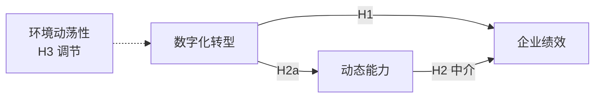

# 科研绘图规范

## 必备图清单（MBA 论文）

| 图 | 出现位置 | 类型 | 交付形式 |
|---|---|---|---|
| 技术路线图 | 第 1/3 章 | 流程图 | Mermaid 源码 |
| 理论框架 / 研究模型图 | 第 2 章末 | 关系图 | Mermaid 源码 |
| 样本/数据结构图（可选） | 第 3 章 | 流程或饼图 | Mermaid 或数据图 |
| 描述统计图 | 第 4 章 | 柱状/折线/箱线 | 绘图脚本或操作步骤 |
| 假设检验结果汇总 | 第 4 章末 | 模型图+标注 | Mermaid |
| 简单斜率图（调节效应） | 第 4 章 | 折线 | 绘图脚本 |
| 案例编码链示意（案例类） | 第 4 章 | 层级图 | Mermaid |

技术路线图若开题报告已有，正文版必须与之一致；有改动先说明。

## Mermaid 源码要求

- 流程图用 `flowchart TD`，自上而下；理论模型用变量框 + 箭头标注 H1/H2
- 每张图附一句"渲染说明"（Mermaid Live Editor / Typora / 支持 Mermaid 的编辑器可直接渲染）
- 节点文字用短句，不超过 15 字；箭头上标假设编号

示例（理论模型）：



## 数据图交付方式（不代出假数据图）

- 用户提供真实数据 → agent 输出 **Python matplotlib/seaborn 代码**或 **Excel 操作步骤**，用户本机出图
- 代码要求：中文标签字体设置、图例、坐标轴单位、导出 300dpi PNG
- agent 不得在没有真实数据时输出任何带具体数字的图表

## 三线表示例

```
表 4-1 变量的描述性统计

| 变量 | 均值 | 标准差 | 最小值 | 最大值 | 1 | 2 |
|---|---|---|---|---|---|---|
| 数字化转型 | 3.42 | 0.87 | 1.00 | 5.00 | 1 |  |
| 动态能力   | 3.68 | 0.75 | 1.25 | 5.00 | .52** | 1 |
```

（示例数字仅为格式演示，正式稿必须来自真实数据）

## 编号与引用规则

- 图：图 1-1、图 4-2（章-序）；表同规则。全文连续，同章内顺序编号
- 图题在图**下方**，表题在表**上方**
- 每张图表必须被正文引用（"如图 3-1 所示"）；未被引用的图表删除
- 来源标注：自绘标"资料来源：作者绘制"；改绘自文献标"作者根据 XX（年份）整理"

## 不该出现的图

- 纯装饰性图片（无信息量的商务插画）
- 分辨率过低的截图（< 150dpi 的网页截图）
- 与正文数据对不上的图（数字在图和表里不一致 = 硬伤）
- 三维饼图、双轴滥用等误导性图表
